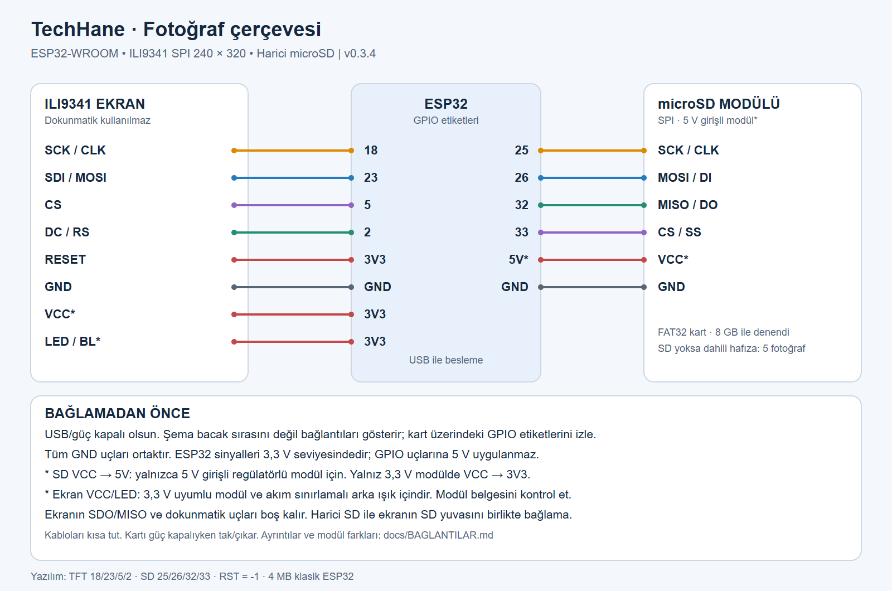

# TechHane Fotoğraf Çerçevesi

**ESP32 + ILI9341 ekran ile telefondan yönetilen fotoğraf çerçevesi · v0.3.4**

Fotoğrafları telefonundan yükle; saat, tarih ve hava durumunu tek satırda göster.
Uygulama indirmek gerekmez, tarayıcı yeterlidir.

- Dikey/yatay kullanım; fotoğrafı doldur veya tamamını sığdır.
- Bilgi satırı üstte, altta veya gizli; üç bilgi için ayrı renk seçimi.
- Otomatik geçiş: 5 saniye–1 saat; duraklatma ve ileri/geri gezinme.
- Fotoğraf parlaklığı ve kontrastı.
- microSD algılanırsa karta kayıt; kart yoksa dahili hafızada en fazla 5 fotoğraf.
- Kayıtlı Wi-Fi ile açılışta internet saati ve düzenli hava durumu güncellemesi.

## Başlamak için

1. [Bağlantıları yap](docs/BAGLANTILAR.md).
2. [İlk kurulumu tamamla](docs/ILK-KURULUM.md).
3. [Fotoğraf yükle ve kullan](docs/KULLANIM.md).

## Gerekenler

Klasik **ESP32-WROOM / ESP32 DevKit (4 MB flash)**, **240 × 320 SPI ILI9341 ekran**,
veri aktarabilen USB kablosu ve bağlantı kabloları. İsteğe bağlı SPI microSD modülü
ve FAT32 kart. 8 GB kartla denenmiştir. Bu hazır yazılım ESP32-C3/S2/S3 veya
farklı ekran sürücüleri için değildir. Ekranın dokunmatiği bu sürümde kullanılmaz.

## Paket içeriği

| Klasör | İçerik |
|---|---|
| `bin/` | Sıfırdan derlenmiş ilk kurulum ve uygulama dosyaları |
| `firmware/FotoCerceve/` | Arduino kaynak kodu |
| `web/` | Cihazın telefon arayüzü ve çizim verileri |
| `docs/` | Kısa kılavuzlar, PNG/SVG bağlantı şeması |
| `tools/` | Taşınabilir derleme ve yükleme araçları |
| `licenses/`, `assets/` | Üçüncü taraf bildirimleri ve açık lisanslı yazı tipi |

## Paylaşım ve gizlilik

Paket kişisel fotoğraf, ev ağı adı/şifresi, kayıtlı konum, cihaz hafıza yedeği veya
geliştirme günlükleri içermez. Albüm ve ev ağı ayarları yeni kurulumda boştur.
`Techhane123`, yalnızca bu herkese açık sürümün **genel kurulum ağı şifresidir**;
kişisel bir Wi-Fi şifresi değildir. Ağ adı `TechHane_Cerceve`.

Yönetim sayfasında ayrıca kullanıcı girişi yoktur. Çerçeveyi güvenilir yerel ağda
kullan; internete port açma. Kurulum ağı şifresi kaynak kodundaki `Config.h`
üzerinden değiştirilip yeniden derlenebilir. Ev Wi-Fi şifresi cihazda saklanır;
cihazın tam hafıza yedeğini veya SD albümünü GitHub'a yükleme.

Fotoğraflar çerçevede kalır. Saat için NTP, konum araması ve hava durumu için
Open-Meteo kullanılır; seçilen konum hava servisine gönderilir.
[Hava verisi: Open-Meteo](https://open-meteo.com/) · [Veri lisansı](https://creativecommons.org/licenses/by/4.0/).

Ekran çözünürlüğü 240 × 320'dir. SD kart fotoğraf sayısını artırır; ekran
çözünürlüğünü artırmaz ve telefon fotoğraflarının orijinallerini arşivlemez.
Saat dilimi Türkiye (UTC+3); diğer ülkelerin şehirleri seçilse de saat dilimi değişmez.

## Geliştirme ve lisans

[Derleme](docs/DERLEME.md) · [Sürüm notları](CHANGELOG.md) · [Doğrulama](docs/DOGRULAMA.md)

Projenin özgün kodu MIT lisanslıdır. Bağımlılıklar kendi lisanslarını korur:
[LICENSE](LICENSE), [THIRD_PARTY.md](THIRD_PARTY.md).
