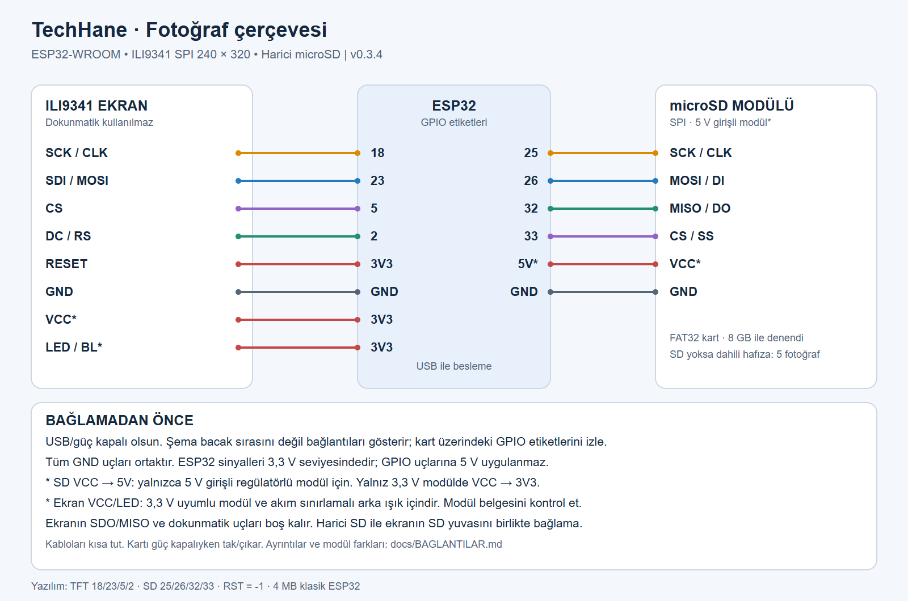

# Bağlantılar

USB/güç kapalıyken bağla. Numaralar **GPIO etiketleridir**, fiziksel bacak sırası
değildir. ESP32 DevKit sürümlerinin pin sırası değişebilir.

[Büyütülebilir SVG şema](baglanti-semasi.svg)

## ILI9341 SPI ekran — 240 × 320

| Ekran ucu | ESP32 |
|---|---|
| SCK / CLK | GPIO 18 |
| SDI / MOSI | GPIO 23 |
| CS | GPIO 5 |
| DC / RS | GPIO 2 |
| RESET / RST | 3V3; yazılımda RST = -1 |
| GND | GND |
| VCC | 3V3, **3,3 V beslemeyi destekleyen ekran modülü için** |
| LED / BL | 3V3, **direnç/sürücü içeren 3,3 V uyumlu arka ışık girişi için** |
| SDO / MISO | Bağlanmaz |
| T_CLK, T_CS, T_DIN, T_DO, T_IRQ | Bağlanmaz; dokunmatik kullanılmıyor |

Ekran modülünün VCC ve LED besleme bilgilerini kontrol et; çıplak panel veya
akım sınırlaması olmayan LED doğrudan bu tabloya göre bağlanmaz. 5 V giriş
isteyen bir modülün VCC bağlantısı kendi belgesine göre yapılır. Sinyaller 3,3 V'tur.

## Harici SPI microSD modülü — isteğe bağlı

| microSD modülü ucu | ESP32 |
|---|---|
| SCK / CLK | **GPIO 25** |
| MOSI / DI | **GPIO 26** |
| MISO / DO | **GPIO 32** |
| CS / SS | **GPIO 33** |
| GND | GND — ekran ve ESP32 ile ortak |
| VCC | **5V/VIN (USB 5 V hattı)**, yalnızca 5 V girişli regülatörlü modül için |

Şemadaki harici modül 5 V besleme kabul eden, 3,3 V sinyal uyumlu SPI modülüdür.
**Regülatörsüz, yalnızca 3,3 V modülde VCC → 3V3 olmalıdır; 5 V bağlama.**
Kartın üzerindeki model/etiketi kontrol et. ESP32'nin hiçbir GPIO ucuna 5 V verme.
VIN'in USB'den 5 V taşıyıp taşımadığı geliştirme kartına göre değişir; kart belgesine bak.

[Denemede kullanılan modül türü: Voltaj PMU242](https://www.voltaj.net/arduino-micro-sd-kart-okuyucu-modul-pmu242).
Satıcı SPI, regülatör ve 3,3/5 V uyumu bildirir. 8 GB FAT32 kartla harici
okuyucunun çalıştığı kullanıcı tarafından doğrulanmıştır.

Ekranın üzerindeki SD yuvasını kullanacaksan SD_SCK/SD_MOSI/SD_MISO/SD_CS
uçlarını yine 25/26/32/33'e bağla; beslemesi ekran kartından gelir. **Harici
okuyucu ile ekranın SD yuvasını aynı anda bu dört hatta bağlama.**

Ekran ve SD ayrı SPI hatları kullanır. Kabloları kısa tut; kartı güç kapalıyken
takıp çıkar. ESP32'yi veri kablosu üzerinden kararlı bir USB kaynağıyla besle.
